# 农场管理系统（小程序）--论文pf

> 🎓 **计算机毕业设计 · 农场管理系统（小程序）--论文pf**
>
> 本仓库只放**项目介绍 + 运行截图**（截图是站点带水印的原图，存在仓库 `images/` 里）。
>
> 👉 **完整可运行源码 / 数据库脚本 / 部署文档：[点我获取](https://geekcode.top/archives/%E5%86%9C%E5%9C%BA%E7%AE%A1%E7%90%86%E7%B3%BB%E7%BB%9F%EF%BC%88%E5%B0%8F%E7%A8%8B%E5%BA%8F%EF%BC%89-%E8%AE%BA%E6%96%87pf?utm_source=github)**
>
> 💬 咨询微信：**ir9372**　|　🌐 更多项目：[极客代码 geekcode.top](https://geekcode.top/?utm_source=github)
>
> 📌 项目详情页：<https://geekcode.top/archives/%E5%86%9C%E5%9C%BA%E7%AE%A1%E7%90%86%E7%B3%BB%E7%BB%9F%EF%BC%88%E5%B0%8F%E7%A8%8B%E5%BA%8F%EF%BC%89-%E8%AE%BA%E6%96%87pf?utm_source=github>

<table><td width="230" align="center"> <b>扫码加微信 ir9372</b></td><td valign="middle">📦 源码 = 项目介绍 + 全部运行截图 + 数据库 + 部署文档 👉 点上方任意截图，直接跳到 <b>极客代码 geekcode.top</b> 详情页</td></table>

---

<h1>农场管理系统（小程序）--论文pf</h1>
<h2>项目概述</h2>

本项目为“农场管理系统”，旨在通过数字化手段优化农场的信息展示、用户交互及后台管理流程。系统采用微信小程序作为移动端入口，结合 Java Web 后台进行数据管理与业务逻辑处理，构建了一套前后端分离的完整解决方案。核心功能涵盖农场信息发布与浏览、用户注册登录、公告通知推送、在线客服沟通以及农场收藏管理等模块。适用人群主要为农场经营者（管理员）和关注农场动态的消费者或访客（普通用户）。技术架构上，后端基于 Spring Boot 框架集成 MyBatis-Plus 与 Shiro 安全框架，前端小程序通过 RESTful API 与后端交互，实现了高效的数据同步与权限控制，满足了现代化农业信息服务的需求。

<h2>技术架构</h2>

本系统采用经典的前后端分离架构，由微信小程序前端、Java 后端服务及 MySQL 数据库组成。

<strong>1. 后端架构</strong>
后端基于 Spring Boot 框架构建，利用其自动配置特性快速搭建应用骨架。持久层采用 MyBatis-Plus 组件，简化了 SQL 编写并提供了通用的 CRUD 操作接口。安全认证与授权模块使用 Apache Shiro，负责处理用户身份验证及访问控制。视图层虽主要服务于后台管理页面（Thymeleaf），但核心数据交互通过 RESTful API 提供 JSON 格式响应供小程序调用。依赖库包括 <code>spring-boot-starter-web</code>、<code>mybatis-spring-boot-starter</code>、<code>shiro-spring</code> 等。

<strong>2. 前端架构</strong>
前端分为两部分：

<ul>
<li><strong>微信小程序端</strong>：面向普通用户，提供农场浏览、个人中心、消息接收等功能。小程序通过 HTTP 请求调用后端提供的 REST API 获取数据，实现界面渲染与业务逻辑。</li>
<li><strong>Web 管理后台</strong>：面向管理员，基于 Thymeleaf 模板引擎渲染页面，用于执行增删改查等管理操作。</li>
</ul>

<strong>3. 交互方式</strong>
小程序前端与 Java 后端之间通过标准的 REST API 进行通信。所有业务数据以 JSON 格式传输，确保了跨平台兼容性与数据传输的高效性。

<a href="https://geekcode.top/archives/%E5%86%9C%E5%9C%BA%E7%AE%A1%E7%90%86%E7%B3%BB%E7%BB%9F%EF%BC%88%E5%B0%8F%E7%A8%8B%E5%BA%8F%EF%BC%89-%E8%AE%BA%E6%96%87pf?utm_source=github" title="查看完整源码">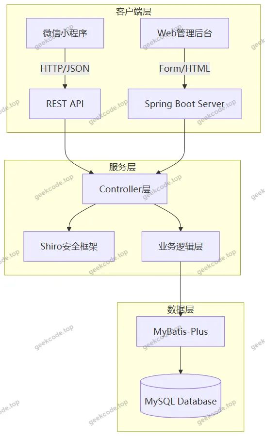</a>

<h2>功能模块</h2>

根据代码上下文中的 Controller 列表、路由配置及截图功能，系统主要划分为以下两大功能板块：

<h3>1. 微信小程序用户端</h3>

该端主要面向普通注册用户，侧重于信息的获取与个人事务管理。

<ul>
<li><strong>用户账户体系</strong>：包含登录、注册、忘记密码及修改密码功能。支持用户完善个人信息（如头像、昵称等）。</li>
<li><strong>农场信息浏览</strong>：展示农场详情列表，支持查看具体的农场介绍、状态等信息。</li>
<li><strong>农场收藏管理</strong>：允许用户对感兴趣的农场进行收藏，并提供收藏列表查看与管理功能。</li>
<li><strong>公告通知中心</strong>：接收并展示系统发布的公告通知列表，确保用户及时获取重要资讯。</li>
<li><strong>在线客服互动</strong>：提供在线客服列表入口，支持用户与客服人员进行即时聊天沟通。</li>
<li><strong>个人中心</strong>：集成上述功能入口，显示用户基本信息及操作记录。</li>
</ul>
<h3>2. Web 后台管理端</h3>

该端面向系统管理员，拥有最高权限，负责全站数据的维护与管理。

<ul>
<li><strong>基础数据字典管理</strong>：</li>
<li>性别字典 (<code>dictionarySex</code>)</li>
<li>农场状态字典 (<code>dictionaryZhuangtai</code>)</li>
<li>论坛状态字典 (<code>dictionaryForumState</code>)</li>
<li>新闻类型字典 (<code>dictionaryNews</code>)</li>
<li>农场分类字典 (<code>dictionaryNongchang</code>)</li>
<li>收藏类型字典 (<code>dictionaryNongchangCollection</code>)</li>
<li>聊天状态字典 (<code>dictionaryChat</code>)</li>
<li><strong>内容信息管理</strong>：</li>
<li><strong>轮播图管理</strong> (<code>huanyuan</code>)：配置首页展示的轮播广告图片。</li>
<li><strong>公告通知管理</strong> (<code>news</code>)：发布、编辑、删除系统公告。</li>
<li><strong>农场信息管理</strong> (<code>nongchang</code>)：录入、更新、下架农场详细资料。</li>
<li><strong>论坛管理</strong> (<code>forum</code>)：若存在论坛模块，则在此进行帖子审核与管理（依据路由推断）。</li>
<li><strong>用户与权限管理</strong>：</li>
<li><strong>用户管理</strong> (<code>users</code>, <code>yonghu</code>)：查看注册用户列表，重置密码，禁用/启用账号。</li>
<li><strong>管理员管理</strong>：对系统内部管理员账号进行维护。</li>
<li><strong>客服聊天管理</strong> (<code>chat</code>)：监控聊天记录，回复用户咨询。</li>
<li><strong>系统配置</strong> (<code>config</code>)：修改系统全局参数。</li>
<li><strong>备份恢复</strong> (<code>beifen</code>)：执行数据库或系统数据的备份与还原操作。</li>
</ul>
<h2>用户角色与权限</h2>

系统主要包含两类角色，权限划分清晰，互不干扰。

<h3>1. 普通用户（小程序端）</h3>
<ul>
<li><strong>权限范围</strong>：仅限读取公开信息及管理个人数据。</li>
<li><strong>可访问功能</strong>：</li>
<li>浏览农场信息列表及详情页。</li>
<li>查看公告通知。</li>
<li>发起或参与在线客服聊天。</li>
<li>添加、取消农场收藏，查看我的收藏列表。</li>
<li>注册新账号，登录已有账号。</li>
<li>修改个人密码，更新个人资料（如头像、姓名、联系方式等）。</li>
<li><strong>禁止操作</strong>：无法进入 Web 后台，无法修改其他用户数据，无法发布或编辑农场信息及公告。</li>
</ul>
<h3>2. 管理员（Web 后台）</h3>
<ul>
<li><strong>权限范围</strong>：拥有系统最高权限，可进行全量数据的增删改查及系统配置。</li>
<li><strong>可访问功能</strong>：</li>
<li><strong>登录后台</strong>：通过专属地址访问管理界面。</li>
<li><strong>内容发布</strong>：创建、编辑、删除农场信息、公告通知、轮播图。</li>
<li><strong>字典维护</strong>：管理各类下拉选项数据（如农场状态、性别等）。</li>
<li><strong>用户监管</strong>：查看所有用户信息，执行封号、解封或密码重置操作。</li>
<li><strong>客服介入</strong>：查看聊天日志，回复用户消息。</li>
<li><strong>系统运维</strong>：修改系统配置参数，执行数据备份与恢复。</li>
<li><strong>论坛/社区管理</strong>：根据路由 <code>/forum</code>，管理员具备对论坛内容的审核与管理权限。</li>
</ul>
<h2>项目特色与创新点</h2>
<ol>
<li><strong>多端协同架构</strong>：项目成功整合了轻量级的微信小程序前端与强大的 Java 后端管理能力。小程序端提供了便捷的移动端体验，适合碎片化时间浏览；Web 后台则提供了丰富的数据管理工具，适合复杂业务处理，两者通过 REST API 无缝衔接。</li>
<li><strong>完善的字典驱动设计</strong>：引入了多个专用字典表（如 <code>dictionaryNongchang</code>, <code>dictionaryZhuangtai</code> 等），将业务枚举值从硬编码中解耦。这种设计使得管理员可以在后台灵活调整农场分类、状态等选项，无需修改代码即可适应业务变化，提升了系统的可维护性。</li>
<li><strong>内置即时通讯能力</strong>：集成了 <code>ChatController</code> 及相关的聊天字典管理，实现了用户与客服的在线实时沟通功能。这不仅增强了用户粘性，也为农场运营方提供了直接的用户反馈渠道，完善了服务闭环。</li>
<li><strong>安全性保障</strong>：采用 Apache Shiro 框架进行权限控制和身份认证，有效防止未授权访问和数据泄露。同时，后台提供的“备份”功能 (<code>/beifen</code>) 确保了关键业务数据的安全性，降低了因误操作或系统故障导致的数据丢失风险。</li>
</ol>
<h2>部署环境</h2>

为确保项目正常运行，需准备以下软件环境：

<ol>
<li><strong>开发语言与运行时</strong>：</li>
</ol>
<ul>
<li>JDK 版本：建议 JDK 8 或 JDK 11（取决于 Spring Boot 具体版本兼容性，通常 Spring Boot 2.x 支持 JDK 8+）。</li>
<li>Node.js：用于前端构建（若小程序涉及 npm 包管理）及可能的本地开发服务器启动。</li>
</ul>
<ol start="2">
<li><strong>数据库</strong>：</li>
</ol>
<ul>
<li>MySQL：版本 5.7 或 8.0，需预先导入项目提供的 SQL 脚本以初始化表结构和基础数据。</li>
</ul>
<ol start="3">
<li><strong>Web 容器与服务框架</strong>：</li>
</ol>
<ul>
<li>Spring Boot：内嵌 Tomcat 或其他 Servlet 容器，无需单独安装外部 Web 服务器。</li>
</ul>
<ol start="4">
<li><strong>客户端工具</strong>：</li>
</ol>
<ul>
<li>微信开发者工具：用于调试、预览和上传微信小程序代码。</li>
<li>浏览器：Chrome 或 Edge，用于访问 Web 管理后台。</li>
</ul>
<ol start="5">
<li><strong>依赖管理</strong>：</li>
</ol>
<ul>
<li>Maven：用于下载和管理 Java 后端项目的第三方依赖库（如 MyBatis-Plus, Shiro 等）。</li>
</ul>
<h2>五、技术特性</h2>
<ul>
<li>前后端集成部署，前端资源打包至后端 static 目录</li>
<li>使用 MyBatis-Plus 简化数据访问层开发</li>
<li>集成 Shiro 权限框架实现角色权限控制</li>
</ul>
<h2>六、功能模块截图</h2>
<h3>微信小程序用户端</h3>

<figure><figcaption>小程序-登录</figcaption></figure>
<figure><a href="https://geekcode.top/archives/%E5%86%9C%E5%9C%BA%E7%AE%A1%E7%90%86%E7%B3%BB%E7%BB%9F%EF%BC%88%E5%B0%8F%E7%A8%8B%E5%BA%8F%EF%BC%89-%E8%AE%BA%E6%96%87pf?utm_source=github" title="查看完整源码">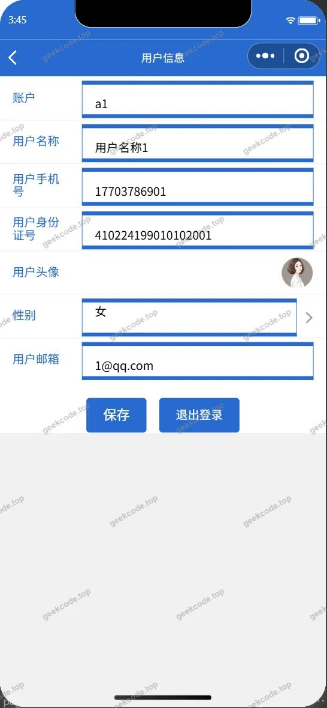</a><figcaption>小程序-个人信息userinfo</figcaption></figure>
<figure><figcaption>小程序-公告通知列表</figcaption></figure>
<figure><a href="https://geekcode.top/archives/%E5%86%9C%E5%9C%BA%E7%AE%A1%E7%90%86%E7%B3%BB%E7%BB%9F%EF%BC%88%E5%B0%8F%E7%A8%8B%E5%BA%8F%EF%BC%89-%E8%AE%BA%E6%96%87pf?utm_source=github" title="查看完整源码">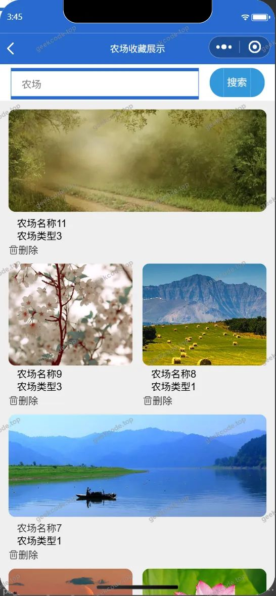</a><figcaption>小程序-农场收藏列表</figcaption></figure>
<figure><figcaption>小程序-农场信息</figcaption></figure>
<figure><a href="https://geekcode.top/archives/%E5%86%9C%E5%9C%BA%E7%AE%A1%E7%90%86%E7%B3%BB%E7%BB%9F%EF%BC%88%E5%B0%8F%E7%A8%8B%E5%BA%8F%EF%BC%89-%E8%AE%BA%E6%96%87pf?utm_source=github" title="查看完整源码">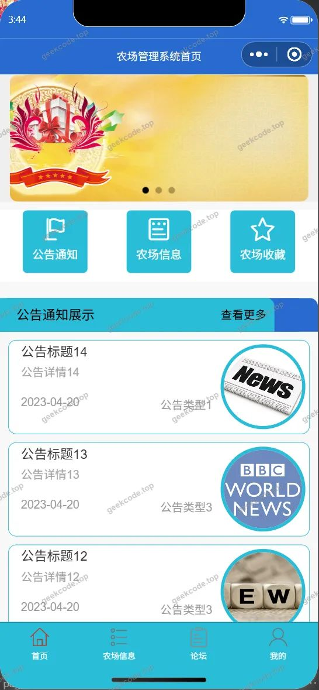</a><figcaption>小程序-首页</figcaption></figure>
<figure><figcaption>小程序-忘记密码</figcaption></figure>
<figure><a href="https://geekcode.top/archives/%E5%86%9C%E5%9C%BA%E7%AE%A1%E7%90%86%E7%B3%BB%E7%BB%9F%EF%BC%88%E5%B0%8F%E7%A8%8B%E5%BA%8F%EF%BC%89-%E8%AE%BA%E6%96%87pf?utm_source=github" title="查看完整源码">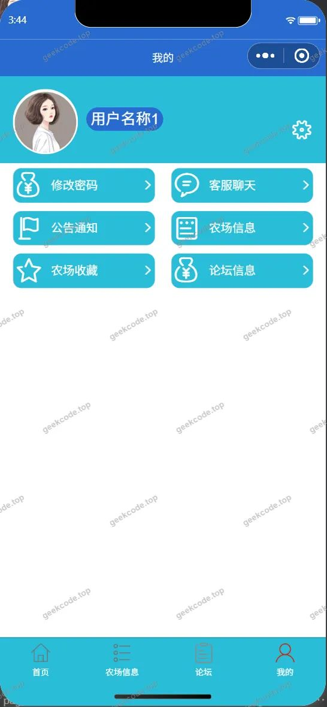</a><figcaption>小程序-我的</figcaption></figure>
<figure><figcaption>小程序-在线客服列表</figcaption></figure>
<figure><a href="https://geekcode.top/archives/%E5%86%9C%E5%9C%BA%E7%AE%A1%E7%90%86%E7%B3%BB%E7%BB%9F%EF%BC%88%E5%B0%8F%E7%A8%8B%E5%BA%8F%EF%BC%89-%E8%AE%BA%E6%96%87pf?utm_source=github" title="查看完整源码">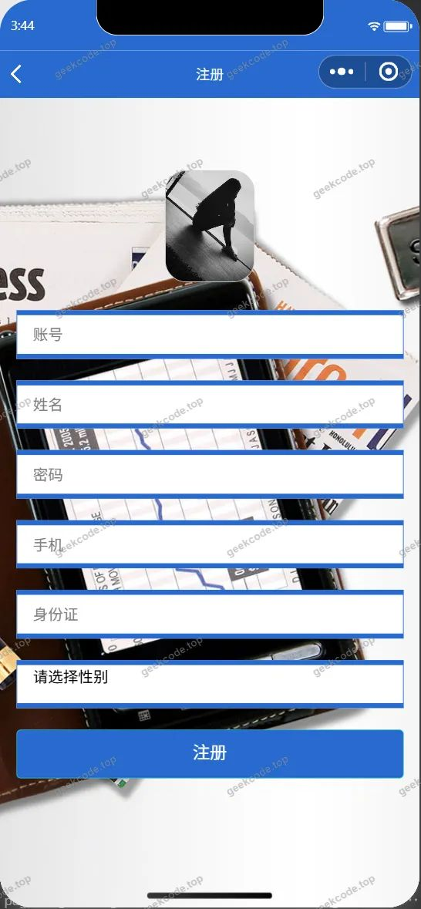</a><figcaption>小程序-注册</figcaption></figure>
<figure><figcaption>小程序-修改密码</figcaption></figure>

<h3>后台管理端</h3>
<h4>后台-在线客服</h4>

<a href="https://geekcode.top/archives/%E5%86%9C%E5%9C%BA%E7%AE%A1%E7%90%86%E7%B3%BB%E7%BB%9F%EF%BC%88%E5%B0%8F%E7%A8%8B%E5%BA%8F%EF%BC%89-%E8%AE%BA%E6%96%87pf?utm_source=github" title="查看完整源码">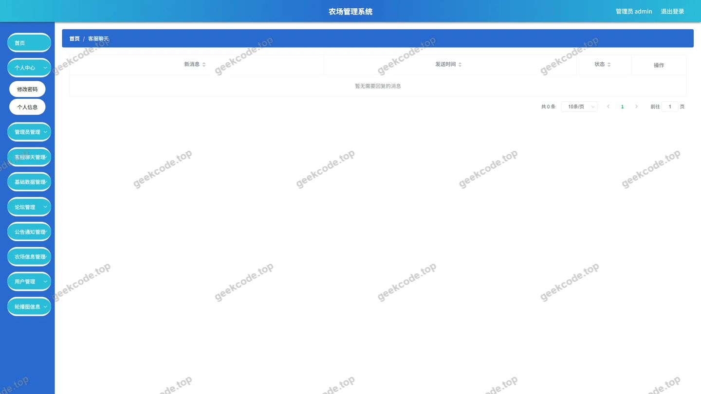</a>

<h4>后台-系统配置</h4>

<a href="https://geekcode.top/archives/%E5%86%9C%E5%9C%BA%E7%AE%A1%E7%90%86%E7%B3%BB%E7%BB%9F%EF%BC%88%E5%B0%8F%E7%A8%8B%E5%BA%8F%EF%BC%89-%E8%AE%BA%E6%96%87pf?utm_source=github" title="查看完整源码">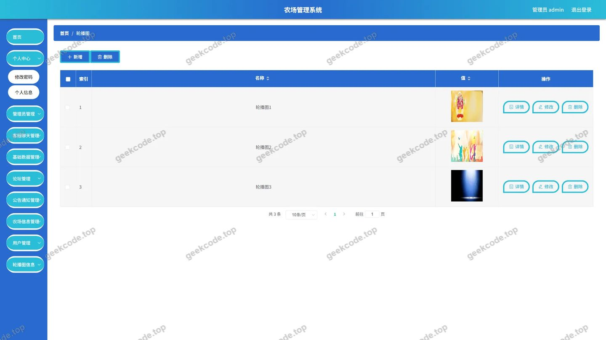</a>

<h4>后台首页</h4>

<a href="https://geekcode.top/archives/%E5%86%9C%E5%9C%BA%E7%AE%A1%E7%90%86%E7%B3%BB%E7%BB%9F%EF%BC%88%E5%B0%8F%E7%A8%8B%E5%BA%8F%EF%BC%89-%E8%AE%BA%E6%96%87pf?utm_source=github" title="查看完整源码">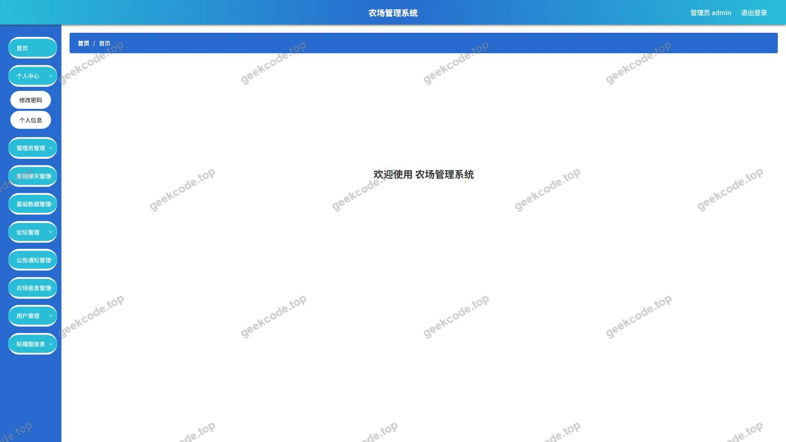</a>

<h4>后台-登录</h4>

<h4>后台-公告信息</h4>

<a href="https://geekcode.top/archives/%E5%86%9C%E5%9C%BA%E7%AE%A1%E7%90%86%E7%B3%BB%E7%BB%9F%EF%BC%88%E5%B0%8F%E7%A8%8B%E5%BA%8F%EF%BC%89-%E8%AE%BA%E6%96%87pf?utm_source=github" title="查看完整源码">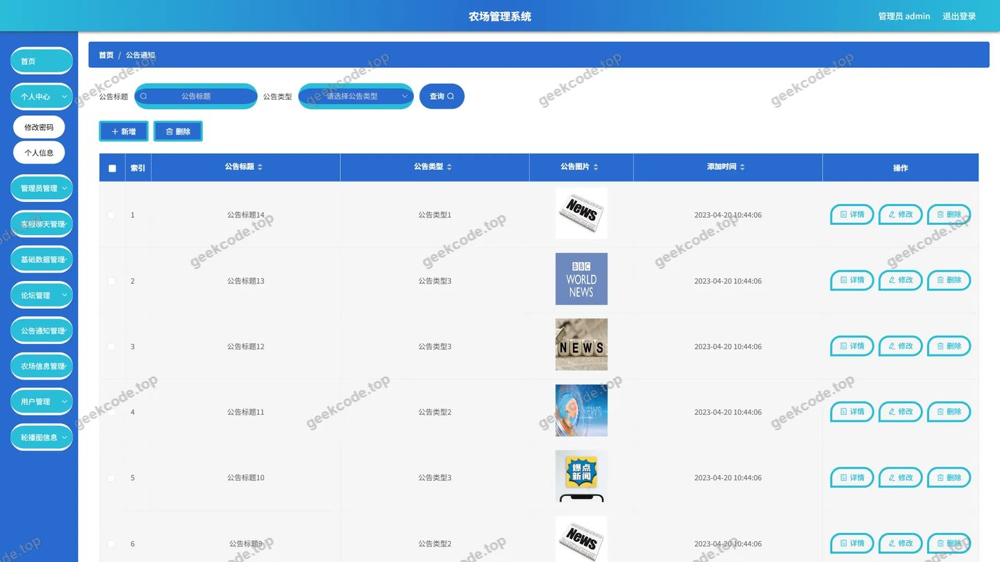</a>

<h4>后台-农场信息</h4>

<a href="https://geekcode.top/archives/%E5%86%9C%E5%9C%BA%E7%AE%A1%E7%90%86%E7%B3%BB%E7%BB%9F%EF%BC%88%E5%B0%8F%E7%A8%8B%E5%BA%8F%EF%BC%89-%E8%AE%BA%E6%96%87pf?utm_source=github" title="查看完整源码">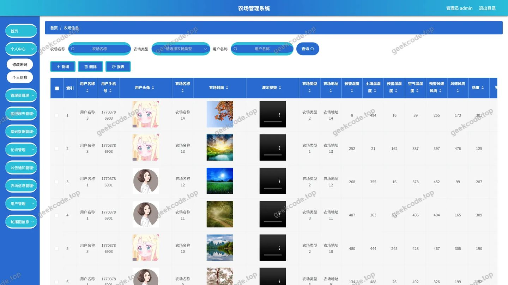</a>

<h4>后台-农场信息收藏</h4>

<a href="https://geekcode.top/archives/%E5%86%9C%E5%9C%BA%E7%AE%A1%E7%90%86%E7%B3%BB%E7%BB%9F%EF%BC%88%E5%B0%8F%E7%A8%8B%E5%BA%8F%EF%BC%89-%E8%AE%BA%E6%96%87pf?utm_source=github" title="查看完整源码">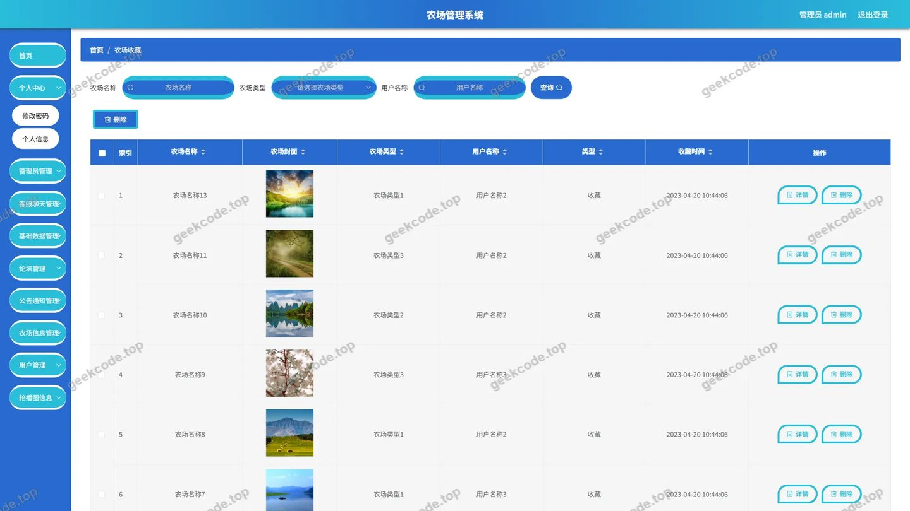</a>

---

## 获取完整源码

| 项目 | 说明 |
| --- | --- |
| 项目名 | 农场管理系统（小程序）--论文pf |
| 运行截图 | 本文 19 张（站点带水印原图，仓库 `images/` 目录） |
| 完整源码 | [https://geekcode.top/archives/%E5%86%9C%E5%9C%BA%E7%AE%A1%E7%90%86%E7%B3%BB%E7%BB%9F%EF%BC%88%E5%B0%8F%E7%A8%8B%E5%BA%8F%EF%BC%89-%E8%AE%BA%E6%96%87pf?utm_source=github](https://geekcode.top/archives/%E5%86%9C%E5%9C%BA%E7%AE%A1%E7%90%86%E7%B3%BB%E7%BB%9F%EF%BC%88%E5%B0%8F%E7%A8%8B%E5%BA%8F%EF%BC%89-%E8%AE%BA%E6%96%87pf?utm_source=github) |
| 咨询微信 | **ir9372**（备注：jingpin-yuanma） |
| 更多项目 | [极客代码 geekcode.top](https://geekcode.top/?utm_source=github) |

> 需要源码、部署、改配置、跑不起来等问题，加微信 ir9372 沟通，说明项目名即可。
